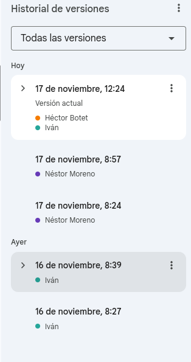

# UD4.1b - Laboratorio: Comparativa de Suites Ofimáticas

* **Módulo:** Implantación de Aplicaciones Web (IAW) · 2º ASIR
* **Centro:** CIPFP Mislata · Curso 2026-27
* **Grupo:** Grupo 2
* **Cliente asignado:** **Cliente B** (Clínica sanitaria, 15 empleados, tratamiento de datos sensibles de salud).
* **Documento descargable:** [Comparativa_Grupo2.docx](./Comparativa_Grupo2.docx)

---

## 1. Tabla Comparativa: Microsoft 365 vs. ONLYOFFICE Workspace

| Criterio | Microsoft 365 (Planes Empresa) | ONLYOFFICE Workspace |
| :--- | :--- | :--- |
| **Herramientas que incluye** | Word, Excel, PowerPoint, Outlook (correo), OneDrive (1 TB/usuario), SharePoint, Microsoft Teams y herramientas de seguridad/cumplimiento (Defender/Purview en Empresa Premium). | Editores de texto, hojas de cálculo y presentaciones (100 % compatibles con OOXML), gestión documental, correo (Mail), CRM, proyectos, calendario y chat. |
| **Modalidad de despliegue** | **SaaS** (100 % en la nube de Microsoft; las apps de escritorio se instalan en local pero dependen de la nube). | **Ambos:** SaaS (nube oficial) o **Autoalojado** (*on-premise* en servidores propios mediante Docker/Linux/Windows). |
| **Licencia y coste** | **Propiaria (suscripción por usuario/mes):** Desde 6,07 €/usuario/mes (Empresa Básico sin Teams: 4,67 €) hasta 27,73 €/usuario/mes (Empresa Premium con Copilot) + IVA ✔. | **Dual:** *Community Edition* gratuita de código abierto (AGPLv3, hasta 20 conexiones simultáneas) y *Enterprise Edition* de pago único/anual por servidor (desde 2.200 $ para equipos pequeños) con soporte y Salas Privadas ✔. |
| **¿Se edita a la vez?** | **Sí**, coautoría en tiempo real mediante Word/Excel/PowerPoint Web y clientes de escritorio sincronizados con OneDrive/SharePoint. | **Sí**, coedición en tiempo real con dos modos: *Rápido* (cambios al instante) y *Estricto* (bloqueo de párrafo hasta guardar). |
| **Dónde se guardan los datos** | En los centros de datos en la nube de Microsoft. Para clientes europeos aplica el **Límite de datos de la UE** (almacenamiento y procesamiento dentro de la Unión Europea) ✔. | En la nube de ONLYOFFICE (servidores en UE o EE. UU. según región elegida) o **en el servidor físico/privado de la propia clínica** si se elige autoalojado. |
| **Punto fuerte** | Ecosistema estándar en el sector, curva de aprendizaje nula y certificaciones sanitarias/legales de máximo nivel (RGPD, ISO 27001, cifrado en tránsito/reposo y DLP) sin requerir mantenimiento de servidores. | Control absoluto y soberanía total de los datos si se autoaloja en la clínica, además de incluir **Salas Privadas** con cifrado de extremo a extremo. |
| **Punto débil** | Coste recurrente mensual por cada empleado y dependencia total de la conectividad y de las políticas de precio de Microsoft. | La versión autoalojada requiere un perfil técnico (administrador de sistemas) para instalar, actualizar, hacer copias de seguridad y asegurar el servidor. |

*(✔ Datos verificados en las webs oficiales de Microsoft 365 y ONLYOFFICE).*

---

## 2. Recomendación para el Cliente B

> **Recomendación: Microsoft 365 (Plan Empresa Estándar o Empresa Premium).**
> Al tratarse de una clínica de 15 empleados con datos de salud (categoría especial según el RGPD), **Microsoft 365** es la opción más segura y rentable: garantiza el almacenamiento dentro de la Unión Europea con cifrado avanzado y políticas de prevención de pérdida de datos (DLP) listas para usar. Descartamos **ONLYOFFICE autoalojado** porque la clínica no cuenta con un departamento IT propio para administrar servidores ni asumir el riesgo legal de mantener la seguridad física y las copias de seguridad de historiales médicos.

---

## 3. Evidencia de Trabajo Colaborativo (Historial de Versiones)

> **Explicación:** En la captura del historial de versiones de Google Docs se observa cómo todos los integrantes del Grupo 2 hemos estado editando y aportando cambios a lo largo de dos días en un único documento compartido, sin necesidad de enviarnos archivos o versiones por correo electrónico.