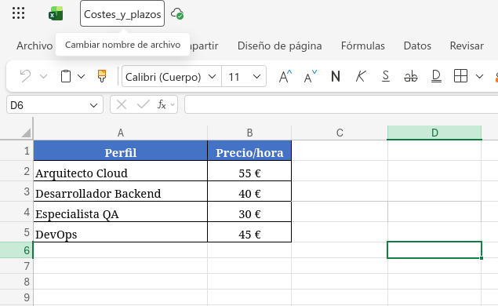
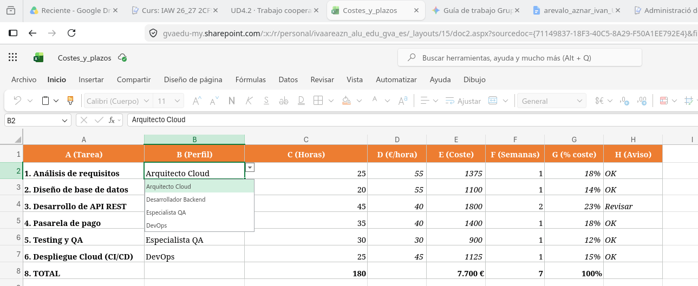
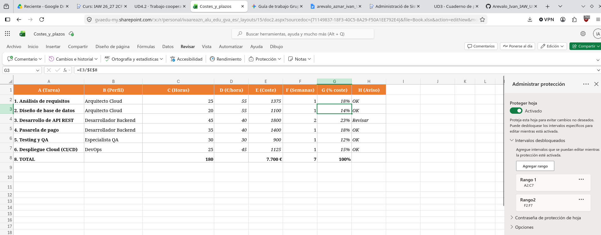
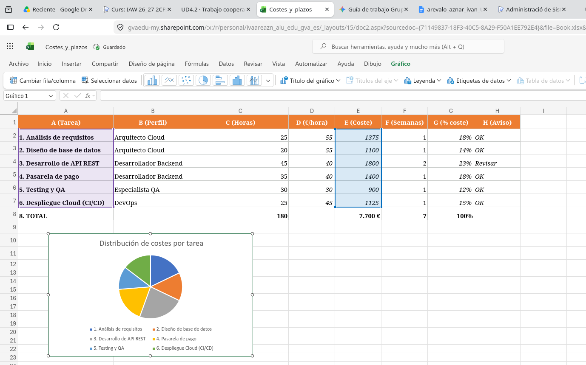

# UD4.2 · Trabajo cooperativo con suites SaaS (Grupo Beta)

* **Módulo:** Implantación de Aplicaciones Web (2º ASIR - CIPFP Mislata)
* **Rol:** Consultoría Beta (Entorno Microsoft 365)
* **Cliente:** Grupo Alpha (Entorno Google Workspace)
* **Proyecto:** Aplicación de gestión de pedidos

---

## Fase 1 · Hoja de cálculo `Costes_y_plazos.xlsx`

### 1. Tabla de Tarifas, cálculos y validación de datos (Puntos B1 y B2)

**Contexto:** 
Creamos el libro `Costes_y_plazos.xlsx` en Microsoft 365 estructurado en dos pestañas (`Tarifas` y `Costes`). Definimos nuestros propios perfiles profesionales y precios por hora, vinculándolos en la hoja principal mediante una lista desplegable (`Datos → Validación de datos`) y calculando costes, porcentajes sobre el total y avisos de carga de trabajo de forma automatizada.

**Deducción:** 
El uso de validación de datos con listas desplegables evita errores tipográficos humanos al asignar perfiles, garantizando que la función `BUSCARV` siempre encuentre una coincidencia exacta en la tabla de tarifas. Asimismo, el uso de referencias absolutas (`$E$8`) en el cálculo de porcentajes permite arrastrar fórmulas sin perder la referencia al presupuesto total, mientras que la función condicional `SI` automatiza la detección de cuellos de botella en tareas que superan las 40 horas.

---

### 2. Protección de celdas y fórmulas (Punto B3)

**Contexto:** 
Para compartir el presupuesto con el cliente (Grupo Alpha) como editores sin riesgo de que alteren la lógica de negocio, desbloqueamos únicamente las columnas de entrada manual (`A`, `B`, `C` y `F`) y activamos la protección de la hoja (`Revisar → Proteger hoja`). Intentamos modificar manualmente una celda de fórmula en la columna de costes (`E`) para verificar la restricción.

**Deducción:** 
La granularidad de permisos a nivel de celda en hojas de cálculo SaaS permite combinar la coedición en tiempo real con la integridad de los datos. El cliente puede simular distintos escenarios modificando horas o semanas en las celdas desbloqueadas y ver el recálculo al instante, pero el sistema bloquea cualquier intento de sobrescribir las fórmulas de precios o totales.

---

### 3. Análisis visual mediante gráfico circular (Punto B4)

**Contexto:** 
Generamos un gráfico circular a partir de las columnas de *Tarea* y *Coste* para ofrecer al cliente una vista ejecutiva del reparto presupuestario del proyecto.

**Deducción:** 
La representación gráfica facilita la toma de decisiones rápidas en reuniones de seguimiento. En nuestro presupuesto, se observa visualmente que la fase de desarrollo técnico (*Desarrollo de API REST* y *Pasarela de pago*) concentra la mayor parte de la inversión, justificando ante el cliente dónde se destina el mayor esfuerzo de ingeniería.

---

## Fase 2 y 3 · Interacción en Google Workspace (Punto B5)

### 4. Comentario con mención en el documento de requisitos

**Contexto:** 
Accedimos como editores al Google Docs *"Requisitos del software"* compartido por el Grupo Alpha. Seleccionamos un requisito funcional que necesitaba concreción técnica e insertamos un comentario mencionando directamente (`@`) a un miembro de Alpha para solicitar aclaración.

**Deducción:** 
Las menciones (`@`) en suites ofimáticas en la nube transforman un comentario pasivo en una notificación activa por correo electrónico, agilizando la resolución de dudas asíncronas y dejando trazabilidad de las decisiones tomadas antes de que el autor marque el hilo como resuelto.

---

### 5. Reunión en Meet y edición en modo Sugerencias en el Acta

**Contexto:** 
Tras aceptar la invitación de Google Calendar (que incluía el enlace directo a nuestro Excel de costes), nos unimos a la videollamada de seguimiento entre ambas parejas. Posteriormente, abrimos el acta *"Acuerdo de colaboración"*, cambiamos el selector superior de *Edición* a **Modo Sugerencias** y propusimos una modificación en uno de los acuerdos numerados.

**Deducción:** 
El **Modo Sugerencias** permite a un colaborador con permisos de edición proponer cambios en el texto sin destruir la redacción original. El cambio queda resaltado y vinculado a la identidad del autor, otorgando al responsable del documento (Alpha) el control final para aceptar o rechazar la modificación con un solo clic.

---

### 6. Respuesta al formulario de seguimiento (Fase 3)

**Contexto:** 
Cada integrante del Grupo Beta accedió al enlace del Google Forms creado por Alpha y completó las 4 preguntas de valoración sobre el estado del proyecto.

**Deducción:** 
Los formularios SaaS permiten recopilar información estructurada de múltiples colaboradores de forma simultánea y volcarla automáticamente a una hoja de cálculo, eliminando la necesidad de consolidar datos manualmente desde correos o mensajes sueltos.

---

## Cierre · Auditoría de permisos en la nube (Punto B6)

### 7. Prueba de acceso en ventana de incógnito

**Contexto:** 
Copiamos la URL de nuestro archivo `Costes_y_plazos.xlsx` (compartido inicialmente solo con cuentas específicas de Alpha y Beta) y lo abrimos en una ventana privada/incógnito sin sesión iniciada. Después, cambiamos temporalmente el enlace a *"Cualquier persona con el enlace"*, recargamos la ventana privada y finalmente volvimos a restringirlo.

**Deducción:** 
Con permisos restringidos a usuarios nominales, la suite exige autenticación previa mediante identidad federada/cuenta corporativa, bloqueando el acceso anónimo. Al activar el acceso mediante enlace público, cualquier usuario que intercepte o reciba la URL puede consultar (o editar, según el rol) el documento sin dejar rastro de su identidad real.

---

## Autoevaluación

1. **¿Qué diferencia hay entre rol comentarista y modo sugerencia?**
   * El **rol comentarista** es un nivel de permiso sobre el archivo: el usuario solo puede leer el documento y añadir notas al margen, sin capacidad para tocar el texto ni activar la edición. El **modo sugerencia**, en cambio, es una herramienta de trabajo disponible para usuarios con permiso de *editor* (o comentarista en Google Docs) que permite escribir propuestas directamente sobre el cuerpo del texto, quedando marcadas para que el propietario las apruebe o descarte.

2. **¿Qué riesgo tiene "cualquiera con el enlace"?**
   * Supone una pérdida total del control de acceso y trazabilidad (auditoría). Si el enlace se reenvía por error, se filtra en un chat o queda indexado, cualquier persona externa a la organización puede acceder a información confidencial (tarifas, datos personales, contratos) de forma anónima, incumpliendo normativas de protección de datos como el RGPD.

3. **¿Qué haría falta para no depender de Google ni de Microsoft?**
   * Sería necesario desplegar una infraestructura de nube privada autoalojada (*on-premise* o en un servidor VPS propio) utilizando software libre/Open Source. Por ejemplo, instalar **Nextcloud** o **OwnCloud** para el almacenamiento y gestión de permisos, integrado con **Collabora Online** o **OnlyOffice Document Server** para la edición colaborativa en tiempo real de documentos, hojas de cálculo y presentaciones.